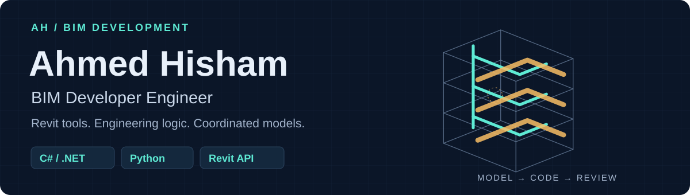
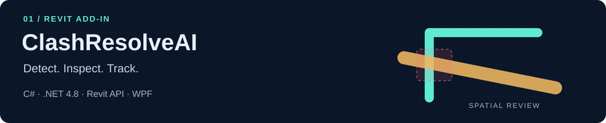
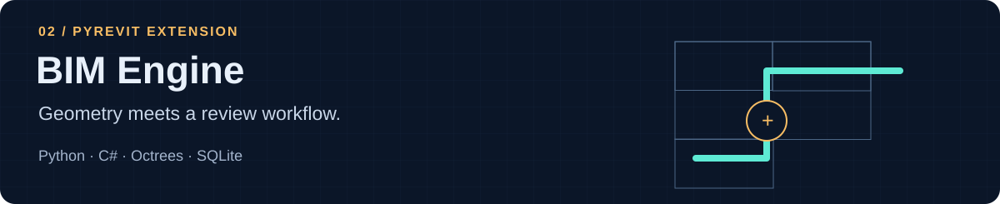
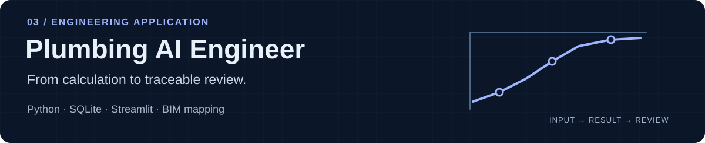
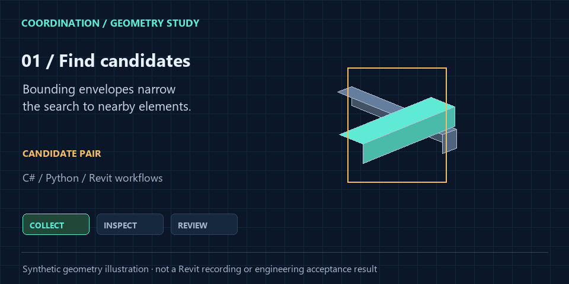
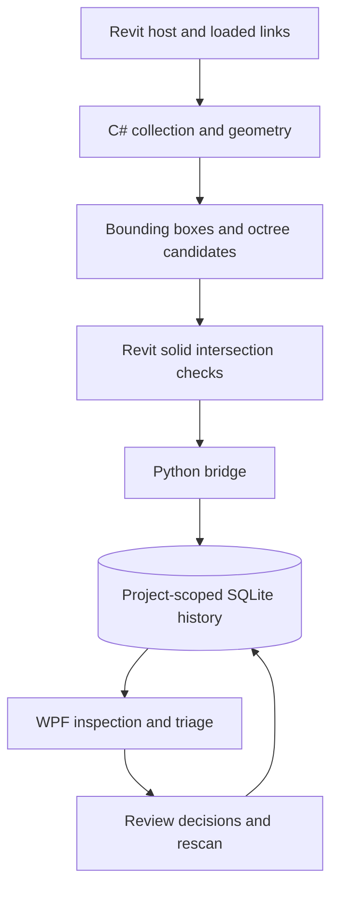

<picture>
  <source media="(prefers-color-scheme: dark)" srcset="assets/header-dark.svg">
  <source media="(prefers-color-scheme: light)" srcset="assets/header-light.svg">
  
</picture>

# Engineering buildings. Developing the tools behind them.

I'm **Ahmed Hisham**, a **BIM Developer Engineer** working across MEP modelling, multidisciplinary coordination and software development. I build **Revit add-ins, geometry tools and Python engineering workflows** that connect model data to practical review and delivery.

**[Explore my portfolio](https://ahmed-hisham-bim-portfolio.ah256.chatgpt.site/) · [Download CV](https://ahmed-hisham-bim-portfolio.ah256.chatgpt.site/documents/ahmed-hisham-cv.pdf) · [LinkedIn](https://www.linkedin.com/in/ahmed-hisham26/) · [Email](mailto:ahmed.hisham2000.ah@gmail.com)**

[Skills](#skills-in-practice) · [Featured tools](#featured-bim-tools) · [Explore](#explore-the-engineering) · [Project work](#engineering-in-context)

## Skills in practice

| Technology | What I build with it | Explore the implementation |
| :--- | :--- | :--- |
| **C# · .NET · Revit API · WPF** | Revit add-ins, modeless dashboards and geometry inspection | [ClashResolveAI](https://github.com/Ah2022/ClashResolveAI/tree/main/src) |
| **Python · pyRevit** | Revit bridges, model data workflows and engineering calculations | [BIM Engine bridge](https://github.com/Ah2022/BIM-Engine/tree/main/BIMEngine.extension/lib/bimengine_core) |
| **Spatial algorithms** | Octree indexing, bounding-box candidate searches and solid intersection checks | [Spatial engine](https://github.com/Ah2022/BIM-Engine/tree/main/BIMEngine.Core/Spatial) |
| **SQLite · SQL** | Project-scoped issue records, scan history and review decisions | [Persistence layer](https://github.com/Ah2022/BIM-Engine/blob/main/BIMEngine.extension/lib/bimengine_core/database.py) |
| **BIM data exchange** | IFC/Revit mapping, connector diagnostics and coordination exports | [BIM mapping](https://github.com/Ah2022/Plumbing-AI-Engineer/blob/main/bim/mapping.py) |
| **TypeScript · React** | Interactive engineering explanations and a coordination sandbox | [Portfolio source](https://github.com/Ah2022/ahmed-hisham-portfolio) |

## Featured BIM tools

### ClashResolveAI

**Find conflicts and keep coordination decisions connected to the model.** A Revit 2024 add-in with solid-based clash checks, local monitoring, geometry inspection, saved scan history and Excel, Word and BCF exports.

[Source code](https://github.com/Ah2022/ClashResolveAI) · [Dashboard guide](https://github.com/Ah2022/ClashResolveAI/blob/main/docs/DASHBOARD_USER_GUIDE.md) · [Validation and limits](https://github.com/Ah2022/ClashResolveAI/blob/main/docs/TESTING.md)

Explore the implementation

- **C# / .NET Framework 4.8**, Revit API, WPF and SQLite.
- Full Scan feeds the Dashboard; Live Monitor feeds Clash Radar. These are separate result scopes.
- Bounding boxes identify candidates; Revit solid intersections confirm hard clashes.
- Optional AI suggestions support review. Geometry detection works without an API key.

### BIM Engine

**Turn model scanning into a repeatable review workflow.** A pyRevit extension combining a C# geometry core with a Python bridge, octree filtering, 2D/3D inspection and persistent issue triage.

[Source code](https://github.com/Ah2022/BIM-Engine) · [User guide](https://github.com/Ah2022/BIM-Engine/blob/main/docs/user-guide.md) · [Architecture and selected code](docs/engineering-notes.md)

Explore the implementation

- **Python + C#**, Revit 2024, WPF and project-scoped SQLite history.
- Host and loaded-link geometry, cached solid extraction and Boolean intersection tests.
- Reviewed/ignored states, notes, assignments and scope-aware rescan history.
- The current implementation checks **hard clashes**; clearance checks, BCF export and AI resolution remain extension points.

### Plumbing AI Engineer

**Connect engineering calculations with traceable BIM review.** A Python/SQLite application with a Streamlit interface for plumbing calculations, hydraulic networks, model mapping and review evidence.

[Source code](https://github.com/Ah2022/Plumbing-AI-Engineer) · [Engineering methods](https://github.com/Ah2022/Plumbing-AI-Engineer/blob/main/docs/PLUMBING_ENGINEERING_MODULES.md) · [Validation status](https://github.com/Ah2022/Plumbing-AI-Engineer/blob/main/docs/ENGINEERING_VALIDATION.md)

Explore the implementation and current status

- **Python**, SQLite, Streamlit, EPANET integration and IFC/Revit mapping.
- Calculation inputs, formulas, units, source references and review status stay connected.
- **Engineering review build:** independent engineering acceptance and a completed native Revit round trip remain pending. Technical test results do not establish code approval.
- Runs locally; the repository does not provide a verified public application deployment.

## Explore the engineering

**[Rotate a 3D service-zone example](examples/service-zone.stl) · [Search a sample issue register](examples/coordination-issues.csv) · [Try the browser coordination sandbox](https://ahmed-hisham-bim-portfolio.ah256.chatgpt.site/#clash-demo)**

The STL and CSV are **synthetic examples** created for this profile. They illustrate geometry and issue data, and are separate from tool exports and real project results. [Explore the example guide](examples/README.md).

Play a short coordination geometry illustration

Candidate filtering → geometry review → revision review. This illustration does not calculate a buildable reroute or demonstrate a tool's runtime performance. [Open the static diagram](assets/coordination-study.png).

See how BIM Engine connects model data, code and review

[Read the architecture and selected source code](docs/engineering-notes.md).

## Engineering in context

My BIM work includes **plumbing and fire protection modelling, coordinated shop drawings and MEP interfaces**. Explore the scope of my contributions:

**[SMC 3 Hospital](https://ahmed-hisham-bim-portfolio.ah256.chatgpt.site/projects/smc-hospital) · [Nile Business City](https://ahmed-hisham-bim-portfolio.ah256.chatgpt.site/projects/nile-business-city) · [CEER Supplier Park](https://ahmed-hisham-bim-portfolio.ah256.chatgpt.site/projects/ceer-automotive-park) · [ENVI Al Shafa](https://ahmed-hisham-bim-portfolio.ah256.chatgpt.site/projects/envi-al-shafa)**

These case studies describe professional project contributions. The tools above are personal development projects; linking them here does not imply deployment on those projects.

My engineering background: mechatronics, robotics and automation

My background in **mechatronics and robotics** informs how I approach building systems: understand the inputs, inspect the interfaces and make behaviour traceable. My earlier work includes C++, Python, embedded systems, MATLAB and ROS.

[Explore my ROS mapping robot](https://github.com/Ah2022/Ros_Mapping_Robot) · [Experience and education](https://ahmed-hisham-bim-portfolio.ah256.chatgpt.site/#experience)

---

**Let's discuss BIM delivery, Revit development or engineering automation.**  
[Email Ahmed](mailto:ahmed.hisham2000.ah@gmail.com) · [Connect on LinkedIn](https://www.linkedin.com/in/ahmed-hisham26/) · [View portfolio](https://ahmed-hisham-bim-portfolio.ah256.chatgpt.site/)
